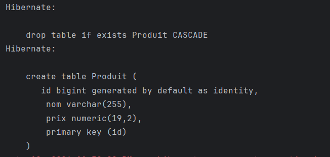
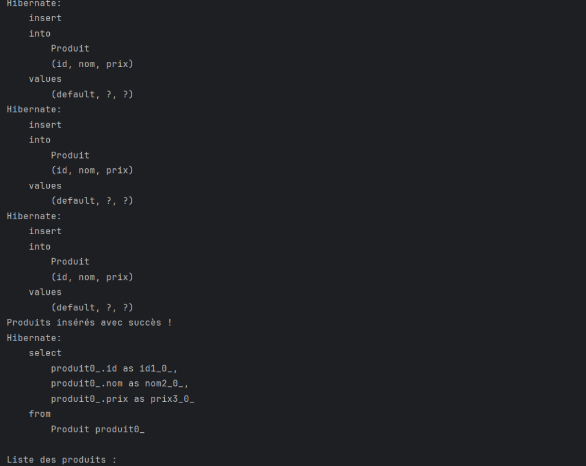
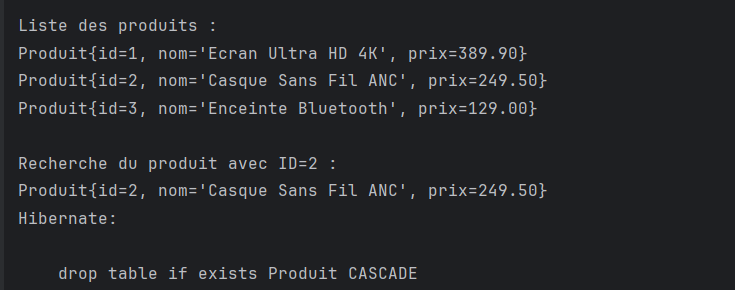
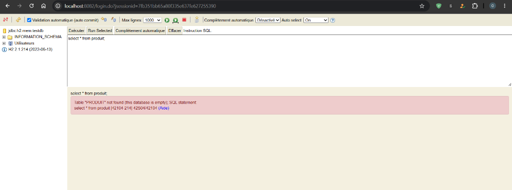

# TPS JEE - JPA / Hibernate

### 1. Création de la table

Génération et exécution automatique du script DDL par Hibernate pour la création de la table `Produit`.

---

### 2. Insertion des produits

Exécution des requêtes SQL `INSERT` par Hibernate et confirmation de l'insertion des produits en base de données.

---

### 3. Affichage et recherche des produits

Affichage de la liste des produits récupérés via JPQL et résultat de la recherche d'un produit spécifique par son identifiant (ID = 2).

---

### 4. Console H2

Tentative d'accès à la table `PRODUIT` dans la console Web H2 après arrêt de l'application (la table a été supprimée suite à la fermeture de l'EntityManagerFactory configuré en `create-drop`).